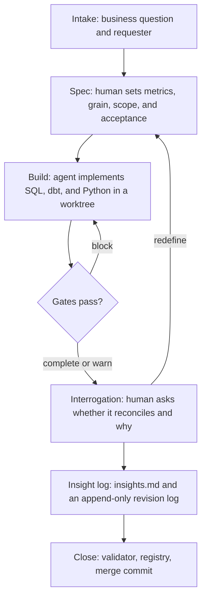

# Analytics Hub Template

A working environment for analysts who want every business question to become a traceable request, every number to pass a deterministic gate, and every interpretation to keep a history.

A human owns the architecture, the metric definitions, the acceptance criteria, and the reading of the result. An agent implements the SQL, the tests, and the scripts. The language model drafts and asks. The warehouse calculates.

```bash
python3 -m venv .venv
source .venv/bin/activate
pip install -r requirements.txt
make demo
```

`make demo` downloads the public Olist e-commerce extract when it can, and otherwise builds a seeded synthetic extract with the same tables. It then runs dbt on local DuckDB, closes request 001, writes the monthly snapshot, and prints a one-line freight check. No warehouse credentials.

Offline from the start:

```bash
make demo-synthetic
```

## Lifecycle



Each request is a folder `requests/NNN-slug/` and one entry in `requests/registry.yaml`. The registry is the only index. Lifecycle status is `open`, `in_spec`, `in_build`, `in_interpretation`, `closed`, or `paused`. Every transition has a date and a reason. Closing outcome is a separate field: `complete`, `partial`, or `blocked`. A paused request cannot carry an outcome.

Git flow: one worktree and one branch per request, named `worktree-request-NNN-slug`. Open it with `git worktree add ../worktree-request-NNN-slug -b worktree-request-NNN-slug`, and close it from the base branch with `git merge --no-ff worktree-request-NNN-slug`. The merge commit keeps the request as its own unit of history. `python scripts/request_worktree.py` prints those commands and does not run them. Before the merge, `python scripts/validate_completion.py --request NNN` prints `complete`, `partial`, or `blocked`. A blocked request stays open. Commit prefixes: `feat(requests)`, `docs(knowledge)`, `docs(quick-check)`, `chore`.

## Principles

1. What can be deterministic is deterministic. SQL, tests, gates, and scripts calculate.
2. The human owns definitions and interpretation. The agent implements.
3. A decision is written down. `ARCHITECTURE.md` and `insights.md` keep an append-only history.
4. Integrity blocks. An anomaly warns. The severity is explicit.
5. A metric is `certified`, `indicative`, or `blocked`. Nothing is published without a status.
6. One source of truth per subject: the registry, the metric card, the request config.
7. A new number is reconciled to an independent source, or the difference is declared.
8. The repository starts private and starts empty of proprietary data.

## What the example answers

Request `001-monthly-conversion-and-revenue` asks how delivered orders and revenue moved, what the ticket was, how many mature customers came back, and what share of visits became orders.

| Metric | Status | Definition |
| --- | --- | --- |
| Delivered orders | certified | Distinct delivered orders, by purchase month |
| Product revenue | certified | Sum of item price on those orders, freight excluded |
| Average ticket | certified | Price plus freight, divided by delivered orders |
| Repurchase rate | indicative | Mature customers with 2 or more orders, over mature customers |
| Visit-to-order conversion | blocked | The dataset has no visits, so the denominator stays uninvented |

The published files appear under `requests/001-monthly-conversion-and-revenue/outputs/` after the command above. A certified answer carries the period, the filters, the unit, and the load time in `publication.json`. The indicative rate keeps the suffix `_indicative`. The blocked metric has no column.

The variation gate warns when delivered orders move by more than 50% against the previous month. On the public extract that warning fires on the early-2017 ramp and on November 2017. The synthetic seed is built so only November 2017 crosses the line. Reconciliation of item value against payments warns above a 0.5% gap and, on both extracts shipped here, stays inside that tolerance. Warnings are listed in `outputs/gate_report.json`. They do not stop the write. A block does, and it leaves the previous publication in place.

A quick check lives in `quick-checks/2018-08-20-freight-share/`. It measures the freight share of the latest complete month and stays a check. The monthly close in `automations/monthly-close/` appends new months and refuses to rewrite a month already in the snapshot. Its rules are in `docs/ARCHITECTURE.md`.

## Layout

| Path | What it holds |
| --- | --- |
| `CLAUDE.md`, `.claude/skills/` | What an agent may implement, and what it leaves to a human |
| `requests/` | One folder per request, plus `registry.yaml` |
| `quick-checks/` | A dated check with notes and a script |
| `knowledge/` | Durable notes and the metric catalog |
| `products/` | A published data product: `contract.md`, `asset.yaml`, and `CHANGELOG.md` |
| `automations/` | A recurring job, with `docs/ARCHITECTURE.md`, config, and tests |
| `dbt/` | Staging, the complete-month rule, marts, and audit views |
| `scripts/connectors/` | DuckDB, Postgres, Databricks SQL, BigQuery, GA4, Azure Blob, Azure DevOps |
| `scripts/gates/` | Pure gate functions and the leak scan |
| `templates/` | Request, architecture, verification, insight, metric card, product asset |
| `tests/` | Gates, catalog, connectors with mocks, leak scan, structure |
| `.github/workflows/ci.yml` | ruff, sqlfluff, pytest, dbt build, structure, language, gitleaks, denylist |

## Gates

| Gate | Severity |
| --- | --- |
| Grain uniqueness | block |
| Temporal coverage | block |
| Scope completeness | block |
| Value domain | block |
| Partial month | block |
| Frozen history | block |
| Metric status | block |
| Publication metadata | block |
| Leak scan | block |
| Reconciliation across sources | warn |
| Anomalous variation | warn |

The runner exits 1 when any block fails. A warn is printed and the exit code stays 0.

## Connectors

Every connector implements `query(sql, params)`, `identity()`, `healthcheck()`, and a context manager that closes the connection. Credentials come from the environment (see `.env.example`). Remote calls use HTTPS, verify TLS, and set a timeout and retries. Postgres accepts only `verify-full` and `verify-ca`.

Connectors are read-only unless `CONNECTOR_ALLOW_WRITE=true`. A read is a single statement whose first verb is `select`, `with`, `show`, `describe`, `explain`, or `values`. `CONNECTOR_DRY_RUN=true` returns the statement and the byte ceiling without a network call. `CONNECTOR_MAX_BYTES` (default 1 GiB) is sent as BigQuery `maximumBytesBilled`. Databricks receives the same ceiling as `byte_limit`, which caps the bytes the Statement API returns. `identity()` returns the account, project, or database and leaves the secret in the process environment.

GA4 is not a SQL engine: `query` takes a JSON RunReport body. Azure Blob takes a blob path and refuses a path that leaves the container. Azure DevOps takes a WIQL statement. Tests mock the network. None of them need a credential.

DuckDB is the default and needs nothing.

## Products

Each directory in `products/` is a published data product. `asset.yaml` names the owner role, the status (`certified`, `indicative`, or `blocked`), the sources, the refresh, and the SLA. `CHANGELOG.md` is append-only. `contract.md` is the functional contract.

## Agent guardrails

`CLAUDE.md` lists the skills. The table is generated from `.claude/skills/*/SKILL.md` by `scripts/render_skills.py`, and CI fails when the committed table drifts.

`.claude/hooks/guard_paths.py` refuses a read or write of `.env` (`.env.example` stays readable), refuses temp directories, and refuses `python`, `pip`, `pytest`, `dbt`, `ruff`, or `sqlfluff` unless the binary is `.venv/bin/...`. Create the environment with `python3 -m venv .venv`.

`.mcp.json` starts `scripts/mcp_wrapper.py`. Tokens stay in the environment or in an OAuth profile outside the repository. The profile has to set `read_only` to true. The JSON file holds no credentials.

`scripts/validate_structure.py` checks the required folders and files, the registry, the metric catalog, each request's documents, each product asset, and each automation's invariants. CI runs it on every change. An automation's `docs/ARCHITECTURE.md` states its invariants, including zero language-model calls at runtime.

## What stays out of git

Raw extracts, warehouse files, request outputs, automation snapshots, dbt's `target/` directory, and logs stay untracked. SQL, Python, YAML, and Markdown stay in git. `.gitignore` lists the heavy patterns, including `*.duckdb`, `*.parquet`, `*.xlsx`, `requests/**/outputs/`, `automations/**/snapshots/`, and `dbt/target/`.

## Keeping internal names out

Two checks run in pre-commit and in GitHub Actions:

1. [gitleaks](https://github.com/gitleaks/gitleaks) scans for secrets.
2. `scripts/gates/leak_scan.py` fails if `.leak-denylist.txt` or `.env` is tracked, and if any term in the local denylist appears in a tracked file.

Copy `.leak-denylist.example.txt` to `.leak-denylist.txt` and replace the placeholder lines with terms that must not ship: internal hostnames, schema names, project codenames. The copy is gitignored. In CI, store the same text in the repository secret `LEAK_DENYLIST`. Until that secret exists, the content scan is a no-op and the index check still runs, so the workflow stays green.

```bash
pre-commit install
```

## Data and license

The code in this repository is MIT. See `LICENSE`. That license covers the template code. The Olist CSVs are a separate work.

The Brazilian E-Commerce Public Dataset by Olist is published on [Kaggle](https://www.kaggle.com/datasets/olistbr/brazilian-ecommerce) under [CC BY-NC-SA 4.0](https://creativecommons.org/licenses/by-nc-sa/4.0/). NonCommercial means the dataset is not for commercial use. ShareAlike means an adaptation of the dataset stays under the same license. This template does not commit those files.

`scripts/prepare_data.py` downloads the CSV sample from [olist/work-at-olist-data](https://github.com/olist/work-at-olist-data). That repository declares MIT on GitHub and is used only as the file source. Treat the CSVs under the canonical Kaggle license, CC BY-NC-SA 4.0, which is the more restrictive license and excludes commercial use. Attribute Olist when you publish a figure from that extract.

The synthetic seed is original, deterministic (`seed=42`), and small. Continuous integration uses it so the build does not depend on the download.

## What to replace when you adopt this

- The requester role, the metric owner, and the "who" on each architecture decision.
- The 0.5% reconciliation tolerance, the 50% variation threshold, and the 90-day repurchase window. They are template assumptions, recorded as such.
- `.leak-denylist.txt` and the `LEAK_DENYLIST` secret.
- `.env` for any remote connector you actually use.
- `.mcp.json`, which starts `scripts/mcp_wrapper.py` and holds no credentials.

The request flow, the registry, the certified / indicative / blocked catalog, the block-versus-warn gates, the frozen snapshot, and the append-only decision logs are the method. The Olist metrics are the public example.

This English file is canonical. `README.pt-BR.md` is an optional Portuguese translation of it.

## Author

Afonso Rocha — [github.com/afonsoalrocha](https://github.com/afonsoalrocha)
