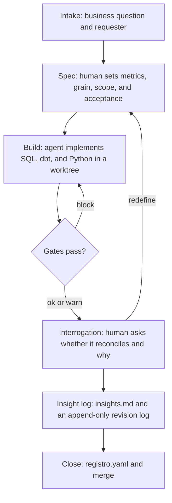

# Analytics Hub Template

A working environment for analysts who want every business question to become a traceable demand, every number to pass a deterministic gate, and every interpretation to keep a history.

A human owns the architecture, the metric definitions, the acceptance criteria, and the reading of the result. An agent implements the SQL, the tests, and the scripts. The language model drafts and asks. The warehouse calculates.

```bash
python3 -m venv .venv
source .venv/bin/activate
pip install -r requirements.txt
make demo
```

`make demo` downloads the public Olist e-commerce extract when it can, and otherwise builds a seeded synthetic extract with the same tables. It then runs dbt on local DuckDB, closes demand 001, writes the monthly snapshot, and prints a one-line freight check. No warehouse credentials.

Offline from the start:

```bash
make demo-synthetic
```

## Lifecycle



Each demand is a folder `demandas/NNN-slug/` and one entry in `demandas/registro.yaml`. The registry is the only index. Status values are `aberta`, `em_spec`, `em_build`, `em_interpretacao`, `fechada`, and `pausada`. Every transition has a date and a reason.

Git flow: one branch per demand, named `worktree-demanda-NNN-slug`. The merge closes the demand. Commit prefixes: `feat(demandas)`, `docs(conhecimento)`, `docs(verificacao)`, `chore`.

## Principles

1. What can be deterministic is deterministic. SQL, tests, gates, and scripts calculate.
2. The human owns definitions and interpretation. The agent implements.
3. A decision is written down. `ARCHITECTURE.md` and `insights.md` keep an append-only history.
4. Integrity blocks. An anomaly warns. The severity is explicit.
5. A metric is `certificada`, `indicativa`, or `bloqueada`. Nothing is published without a status.
6. One source of truth per subject: the registry, the metric card, the demand config.
7. A new number is reconciled to an independent source, or the difference is declared.
8. The repository starts private and starts empty of proprietary data.

## What the example answers

Demand `001-conversao-e-receita-mensal` asks how delivered demand and revenue moved, what the ticket was, how many mature customers came back, and what share of visits became orders.

| Metric | Status | Definition |
| --- | --- | --- |
| Delivered orders | certificada | Distinct delivered orders, by purchase month |
| Product revenue | certificada | Sum of item price on those orders, freight excluded |
| Average ticket | certificada | Price plus freight, divided by delivered orders |
| Repurchase rate | indicativa | Mature customers with 2 or more orders, over mature customers |
| Visit-to-order conversion | bloqueada | The dataset has no visits, so the denominator stays uninvented |

The published files appear under `demandas/001-conversao-e-receita-mensal/outputs/` after the command above. A certified answer carries the period, the filters, the unit, and the load time in `publication.json`. The indicative rate keeps the suffix `_indicativo`. The blocked metric has no column.

The variation gate warns when delivered orders move by more than 50% against the previous month. On the public extract that warning fires on the early-2017 ramp and on November 2017. The synthetic seed is built so only November 2017 crosses the line. Reconciliation of item value against payments warns above a 0.5% gap and, on both extracts shipped here, stays inside that tolerance. Warnings are listed in `outputs/gate_report.json`. They do not stop the write. A block does, and it leaves the previous publication in place.

A quick check lives in `verificacoes-rapidas/2018-08-20-participacao-do-frete/`. It measures the freight share of the latest complete month and stays a check. The monthly close in `automacoes/fechamento-mensal/` appends new months and refuses to rewrite a month already in the snapshot. Its rules are in `docs/ARCHITECTURE.md`.

## Layout

| Path | What it holds |
| --- | --- |
| `CLAUDE.md`, `.claude/skills/` | What an agent may implement, and what it leaves to a human |
| `demandas/` | One folder per demand, plus `registro.yaml` |
| `verificacoes-rapidas/` | A dated check with notes and a script |
| `conhecimento/` | Durable notes and the metric catalog |
| `produtos/` | The contract of a published asset |
| `automacoes/` | A recurring job, with `docs/ARCHITECTURE.md`, config, and tests |
| `dbt/` | Staging, the complete-month rule, marts, and audit views |
| `scripts/connectors/` | DuckDB, Postgres, Databricks SQL, BigQuery, GA4, Azure Blob, Azure DevOps |
| `scripts/gates/` | Pure gate functions and the leak scan |
| `templates/` | Demand, architecture, verification, insight, metric card |
| `tests/` | Gates, catalog, connectors with mocks, leak scan |
| `.github/workflows/ci.yml` | ruff, sqlfluff, pytest, dbt build, gitleaks, denylist |

## Gates

| Gate | Severity |
| --- | --- |
| Grain uniqueness | block |
| Temporal coverage | block |
| Scope completeness | block |
| Value domain | block |
| Partial month | block |
| Frozen history | block |
| Metric status | block |
| Publication metadata | block |
| Leak scan | block |
| Reconciliation across sources | warn |
| Anomalous variation | warn |

The runner exits 1 when any block fails. A warn is printed and the exit code stays 0.

## Connectors

Every connector implements `query(sql, params)`, `healthcheck()`, and a context manager that closes the connection. Credentials come from the environment (see `.env.example`). Remote calls use HTTPS, verify TLS, and set a timeout and retries. Postgres accepts only `verify-full` and `verify-ca`.

GA4 is not a SQL engine: `query` takes a JSON RunReport body. Azure Blob takes a blob path. Azure DevOps takes a WIQL statement. Tests under `tests/connectors/` mock the network. None of them need a credential.

DuckDB is the default and needs nothing.

## Keeping internal names out

Two checks run in pre-commit and in GitHub Actions:

1. [gitleaks](https://github.com/gitleaks/gitleaks) scans for secrets.
2. `scripts/gates/leak_scan.py` fails if `.leak-denylist.txt` or `.env` is tracked, and if any term in the local denylist appears in a tracked file.

Copy `.leak-denylist.example.txt` to `.leak-denylist.txt` and replace the placeholder lines with terms that must not ship: internal hostnames, schema names, project codenames. The copy is gitignored. In CI, store the same text in the repository secret `LEAK_DENYLIST`. Until that secret exists, the content scan is a no-op and the index check still runs, so the workflow stays green.

```bash
pre-commit install
```

## Data and license

The code in this repository is MIT. See `LICENSE`.

The Brazilian E-Commerce Public Dataset by Olist is a separate work, published on [Kaggle](https://www.kaggle.com/datasets/olistbr/brazilian-ecommerce) under CC BY-NC-SA 4.0. This template does not commit those files. `scripts/prepare_data.py` downloads the CSV sample from [olist/work-at-olist-data](https://github.com/olist/work-at-olist-data) and loads orders, items, customers, and payments. Attribute Olist when you publish a figure from that extract.

The synthetic seed is original, deterministic (`seed=42`), and small. Continuous integration uses it so the build does not depend on the download.

## What to replace when you adopt this

- The requester role, the metric owner, and the "who" on each architecture decision.
- The 0.5% reconciliation tolerance, the 50% variation threshold, and the 90-day repurchase window. They are template assumptions, recorded as such.
- `.leak-denylist.txt` and the `LEAK_DENYLIST` secret.
- `.env` for any remote connector you actually use.
- `.mcp.json`, which points at a local filesystem server and is not required to run the demo.

The demand flow, the registry, the certified / indicative / blocked catalog, the block-versus-warn gates, the frozen snapshot, and the append-only decision logs are the method. The Olist metrics are the public example.

A Portuguese companion lives in `README.pt-BR.md`.

## Author

Afonso Rocha — [github.com/afonsoalrocha](https://github.com/afonsoalrocha)
