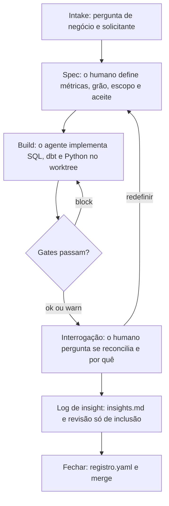

# Analytics Hub Template

Um ambiente de trabalho para analistas em que cada pergunta de negócio vira uma demanda rastreável, cada número passa por um gate determinístico e cada interpretação fica registrada com histórico.

O humano é dono da arquitetura, das definições de métrica, dos critérios de aceite e da leitura do resultado. O agente implementa o SQL, os testes e os scripts. O modelo de linguagem redige e pergunta. O warehouse calcula.

```bash
python3 -m venv .venv
source .venv/bin/activate
pip install -r requirements.txt
make demo
```

`make demo` baixa o extrato público de e-commerce da Olist quando consegue e, na falta dele, monta uma semente sintética com as mesmas tabelas. Em seguida roda o dbt em DuckDB local, fecha a demanda 001, grava o snapshot mensal e imprime uma checagem de frete em uma linha. Nenhuma credencial de warehouse é necessária.

Para começar sem rede:

```bash
make demo-synthetic
```

## Ciclo de vida



Cada demanda é uma pasta `demandas/NNN-slug/` e um item em `demandas/registro.yaml`. O registro é o único índice. Os estados são `aberta`, `em_spec`, `em_build`, `em_interpretacao`, `fechada` e `pausada`. Cada transição tem data e motivo.

Fluxo git: um branch por demanda, no nome `worktree-demanda-NNN-slug`. O merge fecha a demanda. Prefixos de commit: `feat(demandas)`, `docs(conhecimento)`, `docs(verificacao)`, `chore`.

## Princípios

1. O que pode ser determinístico é determinístico. SQL, testes, gates e scripts calculam.
2. O humano é dono das definições e da interpretação. O agente implementa.
3. Decisão fica escrita. `ARCHITECTURE.md` e `insights.md` guardam histórico só de inclusão.
4. Integridade bloqueia. Anomalia alerta. A severidade é explícita.
5. Métrica é `certificada`, `indicativa` ou `bloqueada`. Nada é publicado sem status.
6. Uma fonte de verdade por assunto: o registro, o card da métrica, a config da demanda.
7. Número novo reconcilia com uma fonte independente, ou a diferença fica declarada.
8. O repositório nasce privado e nasce sem dado proprietário.

## O que o exemplo responde

A demanda `001-conversao-e-receita-mensal` pergunta como andaram a demanda entregue e a receita, qual foi o ticket, quantos clientes maduros voltaram e que parcela das visitas virou pedido.

| Métrica | Status | Definição |
| --- | --- | --- |
| Pedidos entregues | certificada | Pedidos distintos com status entregue, no mês da compra |
| Receita de produtos | certificada | Soma do preço dos itens desses pedidos, sem frete |
| Ticket médio | certificada | Preço mais frete, dividido pelos pedidos entregues |
| Taxa de recompra | indicativa | Clientes maduros com 2 ou mais pedidos, sobre os clientes maduros |
| Conversão visita→pedido | bloqueada | O dataset não tem visitas, então o denominador não é inventado |

Os arquivos publicados aparecem em `demandas/001-conversao-e-receita-mensal/outputs/` depois do comando acima. Uma resposta certificada mostra período, filtros, unidade e horário da carga em `publication.json`. A taxa indicativa conserva o sufixo `_indicativo`. A métrica bloqueada não tem coluna.

O gate de variação alerta quando os pedidos entregues oscilam mais de 50% contra o mês anterior. No extrato público esse alerta aparece na rampa de 2017 e em novembro de 2017. A semente sintética foi construída para que só novembro de 2017 ultrapasse a linha. A reconciliação entre o valor dos itens e os pagamentos alerta acima de 0,5% e, nos dois extratos deste template, fica dentro da tolerância. Os alertas ficam em `outputs/gate_report.json`. Eles não impedem a gravação. Um block impede, e deixa a publicação anterior no lugar.

Uma verificação rápida está em `verificacoes-rapidas/2018-08-20-participacao-do-frete/`. Ela mede a participação do frete no último mês completo e continua sendo só uma checagem. O fechamento mensal em `automacoes/fechamento-mensal/` acrescenta meses novos e recusa reescrever um mês que já está no snapshot. As regras estão em `docs/ARCHITECTURE.md`.

## Estrutura

| Caminho | Conteúdo |
| --- | --- |
| `CLAUDE.md`, `.claude/skills/` | O que o agente pode implementar e o que fica com o humano |
| `demandas/` | Uma pasta por demanda, mais `registro.yaml` |
| `verificacoes-rapidas/` | Uma checagem datada, com notas e script |
| `conhecimento/` | Notas duráveis e o catálogo de métricas |
| `produtos/` | O contrato de um ativo publicado |
| `automacoes/` | Uma rotina recorrente, com `docs/ARCHITECTURE.md`, config e testes |
| `dbt/` | Staging, a regra de mês completo, marts e views de auditoria |
| `scripts/connectors/` | DuckDB, Postgres, Databricks SQL, BigQuery, GA4, Azure Blob, Azure DevOps |
| `scripts/gates/` | Funções puras de gate e o leak scan |
| `templates/` | Demanda, arquitetura, verificação, insight, metric card |
| `tests/` | Gates, catálogo, conectores com mock, leak scan |
| `.github/workflows/ci.yml` | ruff, sqlfluff, pytest, dbt build, gitleaks, denylist |

## Gates

| Gate | Severidade |
| --- | --- |
| Unicidade do grão | block |
| Cobertura temporal | block |
| Completude de escopo | block |
| Domínio de valores | block |
| Mês parcial | block |
| Histórico congelado | block |
| Status da métrica | block |
| Metadados da publicação | block |
| Leak scan | block |
| Reconciliação entre fontes | warn |
| Variação anômala | warn |

O runner sai com código 1 se houver qualquer block. Um warn é impresso e o código de saída continua 0.

## Conectores

Cada conector implementa `query(sql, params)`, `healthcheck()` e um contexto que fecha a conexão. Credenciais vêm do ambiente (veja `.env.example`). Chamadas remotas usam HTTPS, verificam TLS e declaram timeout e retentativas. O Postgres aceita só `verify-full` e `verify-ca`.

GA4 não é um motor SQL: `query` recebe um JSON de RunReport. O Azure Blob recebe o caminho do blob. O Azure DevOps recebe uma sentença WIQL. Os testes em `tests/connectors/` usam mock e não precisam de credencial.

O padrão é DuckDB, sem credencial.

## Como impedir que nomes internos vazem

Dois checks rodam no pre-commit e no GitHub Actions:

1. O [gitleaks](https://github.com/gitleaks/gitleaks) procura segredos.
2. `scripts/gates/leak_scan.py` falha se `.leak-denylist.txt` ou `.env` estiver no índice do git, e se qualquer termo da denylist local aparecer num arquivo rastreado.

Copie `.leak-denylist.example.txt` para `.leak-denylist.txt` e troque as linhas de exemplo por termos que não podem sair: hostnames internos, nomes de schema, codinomes de projeto. A cópia fica no `.gitignore`. No CI, guarde o mesmo texto no secret `LEAK_DENYLIST` do repositório. Enquanto o secret não existir, a varredura de conteúdo não faz nada e a checagem de índice continua, então o workflow permanece verde.

```bash
pre-commit install
```

## Dados e licença

O código deste repositório é MIT. Veja `LICENSE`.

O Brazilian E-Commerce Public Dataset by Olist é uma obra à parte, publicada no [Kaggle](https://www.kaggle.com/datasets/olistbr/brazilian-ecommerce) sob CC BY-NC-SA 4.0. Este template não versiona esses arquivos. `scripts/prepare_data.py` baixa a amostra CSV de [olist/work-at-olist-data](https://github.com/olist/work-at-olist-data) e carrega pedidos, itens, clientes e pagamentos. Atribua a Olist quando publicar um número desse extrato.

A semente sintética é original, determinística (`seed=42`) e pequena. A integração contínua usa essa semente para não depender do download.

## O que trocar ao adotar

- O papel do solicitante, o dono da métrica e o "quem" de cada decisão de arquitetura.
- A tolerância de 0,5% na reconciliação, o limiar de 50% na variação e a janela de 90 dias da recompra. São premissas do template, e estão registradas como tal.
- `.leak-denylist.txt` e o secret `LEAK_DENYLIST`.
- `.env`, para cada conector remoto que você for usar de verdade.
- `.mcp.json`, que aponta para um servidor de filesystem local e não é necessário para o demo.

O fluxo de demandas, o registro, o catálogo certificada / indicativa / bloqueada, os gates de block e warn, o snapshot congelado e os logs de decisão só de inclusão são o método. As métricas da Olist são o exemplo público.

A versão em inglês está em `README.md`.

## Autor

Afonso Rocha — [github.com/afonsoalrocha](https://github.com/afonsoalrocha)
